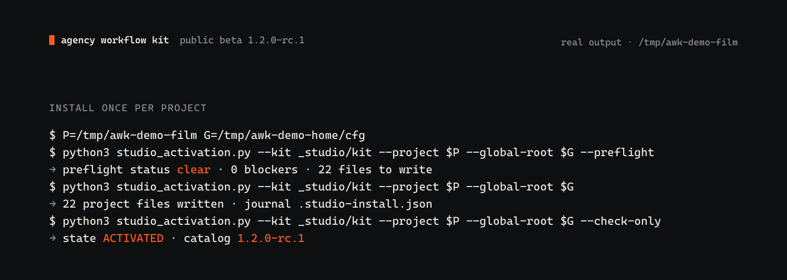
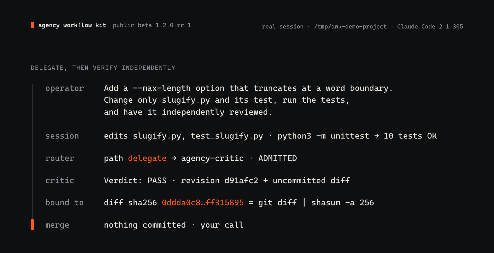
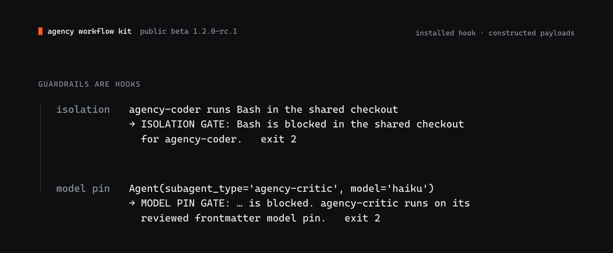

# Agency Workflow Kit

 

> **Public beta: `1.2.0-rc.1`. Not stable.** Interfaces, files and commands may change before `1.2.0`. Read [Known limitations](RELEASE-NOTES.md#known-limitations) before you use it on a project that matters.

Agency Workflow Kit adds a governed way of working to [Claude Code](https://docs.claude.com/en/docs/claude-code/overview). Your session routes each task, bounded specialists do the work, an independent Critic checks the exact revision, and nothing merges, deploys or ships until you say so.

**[Start with the Quick Start →](QUICKSTART.md)**

## What you get

- **A Front Door.** Your plain Claude Code session in an activated project. An installed router picks the route for each task: `DIRECT`, `DELEGATE` or `DIRECTOR`.
- **Five Kit agents** with fixed roles, pinned models and bounded tools: a director and four specialists (researcher, coder, resolver, critic).
- **Independent review.** When you ask for independent verification, a fresh `agency-critic` checks the exact revision. A re-read by the same session does not count.
- **Gates that stop.** Work that needs your decision ends in `GATED` and waits for you.
- **Guardrail hooks.** Bash calls from the coder, the resolver or director-led work in a shared checkout, and per-call model overrides, are blocked before they run.
- **A clean lifecycle.** Preflight, activate, verify, update and uninstall. Every write is journaled.

## See it in action

The first four cards come from real commands and sessions against copies of a small example project in a disposable setup. The guardrails card feeds test calls to the installed hook. The label at the top right of each card names its source, and for sessions the Claude Code version. On session cards, the `operator` row is the exact prompt given to the session. Every other value is copied from the session's output, except the `on-ramp` row on the vague-ask card, which comes from a separate run of the on-ramp CLI in the same folder. The sessions ran headless with permission prompts turned off, on Claude Code `2.1.305` and `2.1.306`. Those are newer patch versions than the formally qualified `2.1.301`.

**Install once per project.** Preflight is read-only. Activation writes 22 project files and journals them. `--check-only` exits 0 only when the state is `ACTIVATED`.

**A vague ask gets questions, not edits.** Given the prompt "Make the slugify tool better.", the session tested the tool, listed real defects and asked how far to go. It changed no files. For materially ambiguous requests the Kit also has a clarification on-ramp that routes to `studio-grill` and does no work.

**Delegate, then verify independently.** A bounded change: the session edited two files and ran the tests. For the review it called the router, which returned `delegate` to `agency-critic`. The Critic's PASS names the base commit and the SHA-256 of the exact diff, and `git` reproduces both. Nothing was committed.

**Bigger work runs governed.** A release with an explicit approval step routed to `DIRECTOR`. `agency-director` worked in an isolated worktree, `agency-coder` built the change and a fresh `agency-critic` passed the exact commit. The Kit's authorization check then escalated the release to you and stopped. `main` was untouched and no tag was created.

**Guardrails are hooks.** Given test calls, the installed hook refuses a specialist's Bash call in the shared checkout and refuses an `Agent` call that overrides a pinned model. Both exit with code 2 and say why.

## The five agents

Installed to `~/.claude/agents`. Each agent's model and effort are pinned in its own frontmatter.

| Agent | Model | Effort | Tools |
|---|---|---|---|
| `agency-director` | `claude-opus-5` | high | Read, Bash, EnterWorktree, ToolSearch, Agent (the four specialists) |
| `agency-researcher` | `claude-sonnet-5` | medium | Read, Grep, Glob, WebSearch, WebFetch |
| `agency-coder` | `claude-sonnet-5` | high | Read, Edit, Write, Bash |
| `agency-resolver` | `claude-sonnet-5` | high | Read, Edit, Write, Bash |
| `agency-critic` | `claude-opus-5` | high | Read, Bash |

## You stay in charge

- You, the Operator, are the only authority for merges, deploys, publication and anything irreversible. The Kit asks; it does not decide.
- The Kit adds no tools, MCP servers or approvals. Your Claude Code permission settings still apply.
- Uninstall removes only the Kit files that still match its journal and keeps anything you changed.

## Requirements

- macOS or Linux, with `git`.
- Python 3.12 or newer. The Kit uses only the standard library.
- Claude Code CLI. Version `2.1.301` is formally qualified. `2.1.302` has real-project dogfood evidence. Newer patch versions are not formally qualified yet.

**Start Claude Code inside the activated project, or inside the activated worktree.** A session started in another checkout does not load that project's Kit rule or hooks. The [Quick Start](QUICKSTART.md) covers installation, activation, update and removal.

## Known limitations

This is a beta. See [Known limitations](RELEASE-NOTES.md#known-limitations) in the release notes.

## Reporting

- Bugs and questions: open a GitHub issue. Include the Kit version, the Claude Code version (`claude --version`), your OS, and the exact command and output. Remove secrets first.
- Security problems: do not open a public issue. See [SECURITY.md](SECURITY.md).

## License

Licensed under the [Apache License, Version 2.0](LICENSE). See [NOTICE](NOTICE).
